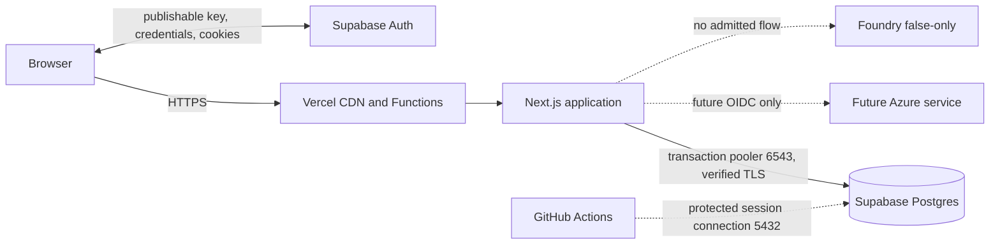

# Architecture

This document is the living source of truth for system shape. The
[repository constitution](CONSTITUTION.md) is binding.

> **Not production configured.** Repository code is implemented and cloud contracts are
> production-shaped, but no Vercel, Supabase, GitHub protected-environment, or Azure deployment is
> evidenced. Provider regions, accounts, SMTP, database roles, retention, recovery, support, and
> residency remain approval gates.

## Status vocabulary

- **Implemented** — executable and tested in this repository; not proof of cloud deployment.
- **Scaffolded-disabled** — represented by code/configuration but externally unconfigured or
  blocked.
- **Future** — absent; admission requires a governed PRD.

## System inventory

| Surface                          | Status                  | Current truth                                                                                                                                                       |
| -------------------------------- | ----------------------- | ------------------------------------------------------------------------------------------------------------------------------------------------------------------- |
| pnpm/Turborepo workspace         | **Implemented**         | One Next.js app and six consumed shared packages use exact versions and explicit exports.                                                                           |
| Neutral web shell                | **Implemented**         | Accessible light/dark/system foundation page with no product behavior.                                                                                              |
| HTTP/oRPC foundation             | **Implemented**         | Raw liveness/readiness and a typed oRPC v1 health contract with safe envelopes.                                                                                     |
| Supabase Auth adapter            | **Implemented**         | Browser credential client, claim-verifying request-scoped Proxy, safe relative return paths, invite-only form, secure production cookies, and local sign-out exist. |
| Supabase Auth service            | **Scaffolded-disabled** | No project, user, password/recovery/MFA policy, signup-denial evidence, signing-key evidence, or production session exists.                                         |
| PostgreSQL package               | **Implemented**         | Empty Drizzle schema, local password mode, Supabase transaction-pool mode, verified TLS, and a session-preserving migration entrypoint exist.                       |
| Supabase Postgres                | **Scaffolded-disabled** | No project, role, credential, certificate setting, backup policy, or runtime/migration connection is evidenced.                                                     |
| Vercel application configuration | **Implemented**         | `apps/web/vercel.json` builds the filtered monorepo application; Next emits platform-native output, not a standalone container.                                     |
| Vercel deployment                | **Scaffolded-disabled** | No linked project, domain, environment settings, Deployment Check, function region, preview, or production deployment is evidenced.                                 |
| Protected migration workflow     | **Implemented**         | Stable GitHub check builds the reviewed Drizzle bundle and runs a port-5432 session migration under an advisory lock.                                               |
| Release controls                 | **Scaffolded-disabled** | The protected `production` environment, reviewers, secrets, branch rules, and Vercel check selection are external.                                                  |
| Structured logging               | **Implemented**         | Pino emits allowlisted PII-safe JSON. No email, token, cookie, body, URL, SQL, or provider error is accepted.                                                       |
| Application telemetry export     | **Scaffolded-disabled** | `azure-monitor` remains a rejected mode; no exporter, connection string, Log Drain, or collector exists.                                                            |
| Azure runtime access             | **Future**              | No Azure consumer or credential exists. Future Vercel access requires exact-subject OIDC federation and narrow RBAC.                                                |
| Foundry                          | **Scaffolded-disabled** | False-only Bicep compiles to zero resources; no account, project, model, agent, store, network, DNS, or RBAC exists.                                                |
| Product data/authorization       | **Future**              | No domain tables, self-service signup, profile, role, permission, or product action exists.                                                                         |

## Project structure

```text
.
├── apps/web/                    # Next.js composition, routes, Auth, probes, Vercel config
├── packages/
│   ├── api-contracts/           # oRPC v1/Zod contracts and safe errors
│   ├── db/                      # Drizzle schema, pools, local/protected migrations
│   ├── env/                     # Browser, runtime, and migration configuration
│   ├── ui/                      # Accessible primitives and semantic tokens
│   ├── eslint-config/
│   └── typescript-config/
├── infra/                       # Zero-resource Azure admission boundary
├── .github/workflows/           # CI, browser, integration, IaC, migration check
├── specs/                       # PRD catalog and design contract
└── docs/                        # ADRs, security records, and runbooks
```

## Context



Vercel, Supabase, and GitHub are independent external processors/control planes. Selecting nearby
regions does not prove residency or a private network path.

## Runtime request flow

1. Vercel terminates HTTPS and routes the request to Next.js.
2. Next.js framework assets and `favicon.ico` bypass Proxy. Exact login/health routes pass Proxy but
   return before any Supabase session call.
3. For protected routes, Proxy creates a request-scoped Supabase server client, copies refresh
   cookies and cache headers, and calls `getClaims()`. `getSession()` is not an authorization
   source.
4. Public `/auth/*` routes continue without a claim. An unauthenticated page receives a `303` to the
   configured application origin; a protected API receives an empty `401`.
5. Authenticated requests reach App Router. Product authorization is still absent and must be added
   per operation by a future PRD.
6. `/health/ready` validates configuration and, when enabled, opens a short-lived `pg` pool,
   executes `select 1`, and closes it. It returns only `ready` or `not_ready`.
7. `/api/v1/*` enters the oRPC OpenAPI dispatcher. Zod/contracts normalize unsupported methods,
   validation failures, missing routes, and unexpected errors into allowlisted envelopes.

## Supabase Auth flow

1. `/auth/login` collects bounded email/password input in the browser.
2. The browser client calls `signInWithPassword` directly against Supabase. The application server
   never receives or logs either credential.
3. Every credential rejection maps to one fixed application message; provider/rate/server
   availability maps to a separate fixed message without raw detail.
4. On success, the client returns only to a server-validated relative path and refreshes the app.
5. Proxy validates subsequent session claims, synchronizes refresh cookies/cache headers, and marks
   production cookies `Secure` with `SameSite=Lax`.

Production acceptance must verify provider-level response and timing equivalence for unknown-user
and wrong-password attempts; client-side message normalization is not sufficient by itself.

Supabase Auth authenticates a subject; it does not grant product permission. Self-service signup,
social providers, profile storage, role mapping, and product authorization are future.

## PostgreSQL boundary

### Runtime

`DATABASE_MODE=supabase-pooler` requires:

- a Supabase shared/dedicated transaction endpoint on port `6543`;
- a dedicated nonadministrator runtime role;
- a protected password and PEM root certificate;
- certificate verification and no full `DATABASE_URL`;
- `DATABASE_POOL_MAX` from `1` to `5`;
- no named prepared-statement contract.

The Vercel function uses a small application pool in front of Supabase's server-side transaction
pooler. The current health probe is the only runtime query.

### Migration

The production entrypoint accepts only `RUNTIME_MODE=production` and the `SUPABASE_MIGRATION_*`
contract. It requires a direct or shared-session endpoint on port `5432`, a distinct migration role,
verified TLS, and one pool connection. That `PoolClient` acquires a nonblocking advisory lock, runs
Drizzle on the same session, unlocks in `finally`, releases the client, and closes the pool.
Contention and errors fail closed.

Migrations never run during install, Next.js/Vercel build, preview creation, or application startup.
Schema changes remain expand/migrate/contract compatible with the currently served deployment.

## Deployment flow

1. Pull requests run deterministic CI, PostgreSQL integration, browser/axe, and zero-resource Bicep
   checks. Vercel Git integration may create a preview using a nonproduction Supabase project.
2. A push to `main` creates a Vercel production build. Required Deployment Checks must hold custom
   domain assignment.
3. The **Supabase production migration** GitHub job waits for protected-environment approval,
   verifies exact source/toolchain, builds/tests the migration artifact, and applies it under the
   advisory lock.
4. Vercel may assign production domains only after that stable check and all other required checks
   pass. Manual staged promotion is an acceptable stronger configuration.
5. Operators verify live/ready, authentication redirect/confirmation, direct provider settings, and
   safe logging. Vercel Instant Rollback may restore prior code, but migrations are forward-only.

Repository workflow presence is not evidence that external protection is configured.

## Configuration contracts

| Environment                       | Host        | Database                                | Auth                         | Telemetry  |
| --------------------------------- | ----------- | --------------------------------------- | ---------------------------- | ---------- |
| Local                             | `local`     | `disabled` or `local-password`          | `disabled` or local Supabase | `disabled` |
| Test/browser CI                   | `local`     | disposable local or disabled            | `disabled`                   | `disabled` |
| Vercel preview/production runtime | `vercel`    | `supabase-pooler`                       | `supabase`                   | `disabled` |
| Protected migration               | no web host | `SUPABASE_MIGRATION_*` session contract | none                         | none       |

Production rejects disabled Auth/database, local passwords, port `5432` runtime traffic, pool size
above five, unverified TLS, default/admin database roles, service-role keys, migration variables in
Vercel, full database URLs, HTTP origins, and Azure Monitor settings.

## Trust boundaries

| Boundary                   | Input                                    | Required behavior                                                                                                                |
| -------------------------- | ---------------------------------------- | -------------------------------------------------------------------------------------------------------------------------------- |
| Browser → Vercel           | Host, path, headers, body                | Vercel owns edge TLS/availability; application still validates every contract.                                                   |
| Browser → Supabase Auth    | Email/password, publishable key, cookies | Exact project/origin, public-signup denial, provider-level enumeration resistance, safe cookies, rate limits, no privileged key. |
| Proxy → application        | Verified claims                          | Authentication only; future handlers authorize server-side and deny by default.                                                  |
| Vercel → Supabase Postgres | SQL/TLS/role credential                  | Transaction pooling, dedicated role, parameterized queries, bounded connections.                                                 |
| GitHub → Supabase Postgres | Migration SQL/TLS/credential             | Protected environment, distinct role, session endpoint, advisory lock, forward-only schema.                                      |
| Runtime → logs             | Structured fields                        | Fixed events and allowlisted low-cardinality metadata only.                                                                      |
| Vercel → future Azure      | OIDC assertion                           | Exact issuer/subject/audience, short-lived exchange, narrow RBAC; currently absent.                                              |

## Observability

The runtime emits only:

- `api.request.completed`
- `api.request.failed`
- `database.probe.completed`
- `runtime.configuration.invalid`
- `telemetry.initialized`

Allowed fields remain correlation/trace/span IDs, bounded duration/status/outcome, fixed component,
database-enabled state, and disabled telemetry mode. Vercel platform logs, request logs, function
logs, drains, retention, support, and region require external review. There is no application trace
export or Azure Monitor path.

## Content Security Policy

Security headers are enforced except CSP, which remains report-only while App Router nonce support
is unfinished. When configured at build time, `connect-src` includes only the exact Supabase project
origin in addition to self. A future enforced policy requires nonce-based streamed scripts and a
safe bounded report collector; raw reports must not be logged.

## Azure and Foundry

`infra/main.bicep` and `infra/modules/foundry.bicep` compile to zero resources. They prove only that
the template does not silently retain Container Apps, Application Gateway, ACR, Key Vault, Azure
PostgreSQL, Azure Monitor, model, or agent resources.

A future Azure consumer must be admitted by a PRD. Vercel can obtain an OIDC assertion with audience
`api://AzureADTokenExchange`; Entra must trust the exact team/project/environment subject and grant
only the required resource role. No wildcard subject, client secret, broad ownership, or dormant
credential is permitted.

## Failure assumptions

- Missing/invalid production configuration fails Proxy and readiness closed.
- Supabase Auth outage blocks login/refresh; it does not create a local bypass.
- Pool exhaustion/database outage makes readiness fail and must not leak connection detail.
- Migration contention/failure blocks the Vercel Deployment Check; no second concurrent migration is
  forced.
- A code rollback does not reverse schema. Repair forward or use a separately approved Supabase
  restore plan.
- Vercel/Supabase regional or control-plane outage has no declared failover.
- Foundry and Azure export/access remain unavailable rather than falling back to static credentials.

## Future admission

New product behavior requires a cataloged PRD. The first persistence PRD must define product schema,
classification, least-privilege grants, authorization, RLS decision, migration compatibility, and
recovery. The first Azure/Foundry PRD must define its consumer, data flow, region, identity,
network, retention, deletion, telemetry, and deterministic test boundary before adding any resource
or SDK call.
