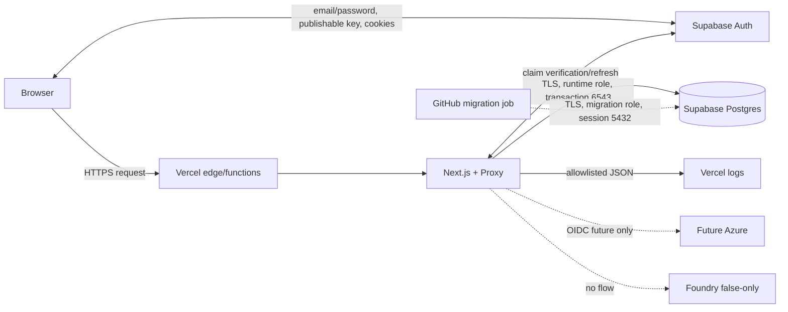

# Threat model

- **Review state:** Vercel/Supabase foundation baseline
- **Last architecture alignment:** 2026-07-27
- **Production state:** Not configured or deployed

This model covers the implemented local/runtime boundaries and unconfigured Vercel/Supabase target.
It does not authorize a product data flow. The [constitution](../../CONSTITUTION.md),
[classification](DATA_CLASSIFICATION.md), [residency matrix](DATA_RESIDENCY.md), and
[logging contract](LOGGING_AND_TELEMETRY.md) are binding.

## Scope

### In scope

- Browser, Vercel request path, Next.js pages, Proxy, probes, and oRPC health
- Supabase Auth publishable configuration, email/password sign-in, cookies, and claims
- Supabase transaction-pool runtime connection and session migration connection
- Drizzle migration bundle, advisory lock, GitHub production migration check
- Structured JSON stdout and Vercel/provider logging exposure
- Source, dependencies, CI/build, Vercel Git integration, and deployment promotion
- False-only Foundry/Azure Monitor/Azure runtime-access boundaries

### Absent and out of scope

- Product routes/data, self-service signup, social login, profiles, roles, permissions, RLS policies
- Supabase Storage, Realtime, Edge Functions, Data API product tables
- A configured cloud environment, customer dataset, live migration, approved recovery plan
- Azure resource or Foundry model/agent/tool/prompt/dataset/trace

## Assets

| Asset                                                       | Classification                               | Objective                                            |
| ----------------------------------------------------------- | -------------------------------------------- | ---------------------------------------------------- |
| Source, lockfile, workflows, provider config                | Internal; security detail Confidential       | Integrity and reviewability                          |
| Auth email/password, access/refresh tokens, and cookies     | Restricted                                   | Confidentiality, one intended audience, no logging   |
| Runtime/migration database credentials and root certificate | Restricted                                   | Provider custody, separation, rotation, verified TLS |
| Email and Supabase Auth user record                         | Restricted until a product PRD classifies it | Purpose limitation, no app storage/logging           |
| Future customer/application data                            | Restricted                                   | Authorization, residency, integrity, deletion        |
| Database schema/migration history                           | Confidential                                 | Forward compatibility and recovery                   |
| Runtime/platform logs                                       | Internal to Restricted by field              | Availability evidence without payload leakage        |
| Vercel/Supabase/GitHub/Azure identifiers                    | Confidential                                 | Integrity, least privilege, no accidental disclosure |

## Data flow

## Existing safeguards

- Strict mode combinations and secret-placement validation
- Request-scoped Supabase SSR clients and `getClaims()` verification
- Invite-only credential form, validated relative return path, secure cookies, fixed Auth errors
- Public health routes separated from external Auth availability
- Dedicated runtime/migration roles, verified root certificate, no `DATABASE_URL`
- Transaction runtime pool bounded to five; migration pool fixed at one session
- Same-session nonblocking advisory lock and forward-only migration policy
- Protected GitHub environment contract and stable Vercel Deployment Check name
- Contract validation, safe errors, no-store responses, security headers, report-only CSP
- Allowlisted logging and prohibited-field redaction
- Exact stable dependencies, strict TypeScript, SHA-pinned actions, deterministic tests
- Zero-resource Azure/Foundry boundary

## Threats and required controls

| ID    | Threat / impact                                      | Current mitigation                                                                      | Residual gap / required action                                                                           |
| ----- | ---------------------------------------------------- | --------------------------------------------------------------------------------------- | -------------------------------------------------------------------------------------------------------- |
| TM-01 | Forged or stale Auth cookie grants access            | Proxy calls `getClaims()`; server never trusts `getSession()` identity                  | Prove asymmetric signing keys, issuer/project, expiry, refresh/revoke behavior in configured environment |
| TM-02 | Authentication mistaken for authorization            | No product action exists; architecture assigns authorization to handlers                | Every product operation needs server-side deny-by-default policy and tests                               |
| TM-03 | Open redirect through the post-login return path     | Server accepts one relative path and rejects `//`, backslash, and control characters    | Keep every future redirect consumer on the shared validator                                              |
| TM-04 | Password/cookie/provider detail enters logs          | Browser submits directly to Supabase; app logs no Auth event/detail; cookies are Secure | Review browser, Vercel, Supabase, support, retention, redaction, and incident exposure                   |
| TM-05 | Account enumeration through credential responses     | Application uses one fixed rejection for all credential errors                          | Prove provider status/body/timing equivalence for unknown-user and wrong-password attempts               |
| TM-06 | Unauthorized self-registration                       | No signup route; production contract requires external public-signup denial             | Prove provider setting and define provisioning/deprovisioning/audit                                      |
| TM-07 | Credential stuffing, brute force, or recovery abuse  | Bounded client input; no local bypass                                                   | Approve password/breach policy, rate/lockout/CAPTCHA, MFA, recovery, monitoring, and support             |
| TM-08 | CSRF/cross-origin state change                       | No product mutation; Next/Supabase cookie flow and same-origin form                     | First mutation PRD must define Origin/CSRF/SameSite/CORS behavior                                        |
| TM-09 | XSS steals session or performs actions               | React escaping, browser headers, report-only restrictive CSP                            | Add per-request nonces and enforce CSP before sensitive product behavior                                 |
| TM-10 | Runtime database credential theft                    | Vercel encrypted setting, dedicated role, no URL/log, TLS verification                  | Configure rotation, network restrictions, role grants, incident revoke, environment access review        |
| TM-11 | Migration credential theft or overprivilege          | Separate GitHub protected secret/role and port-5432 job only                            | Prove environment reviewers, least grants, rotation, audit, and no runtime access                        |
| TM-12 | MITM/downgrade to Supabase                           | PEM root certificate and `rejectUnauthorized=true`; fixed pool ports                    | Approve certificate update/rotation and outage procedure; never switch to unverified `require`           |
| TM-13 | Pool exhaustion/serverless connection storm          | Supabase transaction pooler and app max `1..5`; readiness closes pools                  | Select tier/pool size, monitor utilization, set budgets/alerts, load-test concurrency                    |
| TM-14 | Prepared/session feature failure in transaction mode | No named prepared statement or session-state contract                                   | Test each future query pattern; use session/direct only for approved nonruntime work                     |
| TM-15 | SQL injection or cross-tenant access                 | No product query; parameterized `pg`/Drizzle available                                  | First schema/API PRD defines query parameterization, record scope, RLS decision, negative tests          |
| TM-16 | Unsafe/concurrent migration                          | Protected workflow, one pool session, advisory lock, expand/migrate/contract            | Review generated SQL, locks, backfills, grants, compatibility, and recovery per change                   |
| TM-17 | Vercel releases code before migration                | Stable migration job can be required as Deployment Check                                | Externally configure the check or disable auto-domain assignment; bypass/force-promote policy required   |
| TM-18 | Code rollback conflicts with forward schema          | No down migration; compatibility required                                               | Define forward repair and Supabase restore/PITR evidence before product schema                           |
| TM-19 | Compromised PR/workflow exfiltrates secrets          | Secrets only in protected push/default-branch job; actions pinned                       | Prove branch/environment protection, reviewer independence, action review, and fork isolation            |
| TM-20 | Supply-chain/build compromise                        | Exact versions, lock audit, strict peers, CodeQL, SHA-pinned actions                    | Approve provenance/SBOM, patch cadence, Vercel build access and dependency incident response             |
| TM-21 | Sensitive data enters logs                           | Fixed event/field schemas; no generic message/error/body/URL                            | Review Vercel platform logs and every future event/export; provider logs remain external                 |
| TM-22 | Region/replication/support violates residency        | Preflight requires explicit provider regions and approval                               | Obtain contractual Vercel/Supabase/GitHub/SMTP/support/backup evidence; no current claim                 |
| TM-23 | Vercel edge/function outage or malicious routing     | Health endpoints and instant rollback are available concepts                            | Configure domain/account security, deployment protection, rollback evidence, and RTO/RPO                 |
| TM-24 | Supabase Auth/Postgres outage                        | Readiness/auth fail closed; no unsafe fallback                                          | Select availability tier, backups/PITR, restore drill, incident owner, and acceptable outage behavior    |
| TM-25 | Future Azure secret/lateral movement                 | No Azure consumer/credential; OIDC-only policy                                          | Exact issuer/subject/audience FIC, narrow RBAC, per-environment identities, revocation before enablement |
| TM-26 | Foundry/model data exfiltration                      | False-only zero-resource boundary and no SDK call                                       | Full Foundry admission gates remain mandatory                                                            |

## Production evidence required

Before production, record:

1. Vercel team/project/domain/region, Git integration, environment access, Deployment Checks,
   protection, platform logs, retention, support, rollback, and account security.
2. Supabase organization/project/region, public-signup denial, password/breach/recovery/MFA policy,
   signing keys, rates/lockouts/provisioning/sessions, and database roles/grants/pool
   limits/network/certificate/backups/PITR/support.
3. GitHub branch/ruleset, protected environment/reviewers, secret access, action provenance, log and
   artifact retention.
4. End-to-end classification/residency, retention/deletion, incident, credential rotation, restore,
   RPO/RTO, and named owners.
5. Negative verification for unauthenticated, unknown/wrong credentials, unsafe return path, wrong
   role, TLS failure, pool exhaustion, concurrent migration, failed Deployment Check, and rollback.

No evidence record may contain an email, token, cookie, password, certificate body, connection
string, database row, raw provider response, or production configuration dump.
